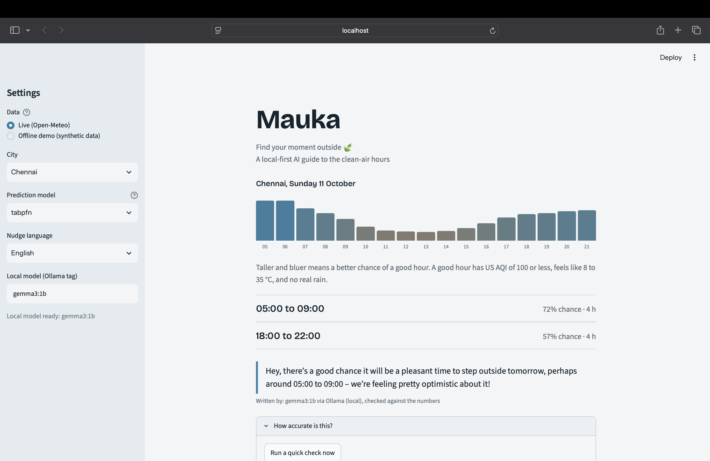

# Mauka (मौका) 🍃

**Find your moment outside. A local-first AI guide to the clean-air hours of a hot, hazy city, built on open data and open models that run on your own laptop.**



**Started:** October 10, 2026, for the Hacktoberfest 2026 DEV Challenge (Week 1: Touch Grass).

## What it does

In many Indian cities, the good hours for being outside are short and change every day. Mauka predicts, for each waking hour of tomorrow (05:00 to 21:00), the chance that it will be a good hour, then shows the best windows and a short nudge.

A "good hour" means all of these are true:
- US AQI of 100 or less
- "Feels like" temperature between 8 and 35 °C
- No real rain (0.5 mm or less)

These limits are my own simple definition, not medical advice. You can change them in `mauka/config.py`.

## How it works

1. **Data:** hourly weather (ERA5) and air quality (Copernicus CAMS) history from [Open-Meteo](https://open-meteo.com). It is free and needs no API key. The history is saved as CSV in `data/` after the first download.
2. **The task:** each row is one hour of one day. From the conditions at that hour plus recent history (yesterday's and 3-day average air quality, the day's peak temperature), predict whether the same hour tomorrow will be good.
3. **Models:** [TabPFN](https://github.com/PriorLabs/TabPFN) is the main model. I compared it with four baselines: persistence ("tomorrow equals today"), climatology (the historical rate for that month and hour), logistic regression and gradient-boosted trees.
4. **The nudge:** a small Gemma model (`gemma3:1b`) runs locally through [Ollama](https://ollama.com) and writes a short message in English, Hinglish or Hindi. It is only given the window times and the chance. The text must contain the exact times and avoid made-up claims, or the app retries once and then falls back to a plain template. The app always shows which one wrote the text.

Nothing leaves your machine except the public weather and air-quality requests.

## Results

Chronological test split: the last 25% of days (2025-09-18 to 2026-10-02), with a one-day gap between training and test. One run per city. Each cell is AUC / Brier score (higher AUC is better, lower Brier is better).

| City | Good hours | Persistence | Gradient boosting | TabPFN |
|---|---|---|---|---|
| Bengaluru | 69% | 0.749 / 0.208 | 0.870 / 0.130 | **0.894 / 0.115** |
| Chennai | 40% | 0.776 / 0.207 | 0.896 / 0.129 | **0.908 / 0.122** |
| Mumbai | 34% | 0.792 / 0.181 | 0.901 / 0.122 | **0.914 / 0.111** |
| Udaipur | 71% | 0.800 / 0.160 | 0.902 / 0.106 | **0.915 / 0.102** |

The full table (accuracy and F1, all five models) is in [`results/summary.md`](results/summary.md).

**How to read this:**
- TabPFN had the best Brier score and AUC in all four cities, and every learned model clearly beat persistence and climatology.
- TabPFN's edge over gradient boosting is small (Brier lower by 0.004 to 0.015, AUC higher by 0.012 to 0.024). This is one split and one run per city with no confidence intervals, so treat the gaps as suggestive, not proven.
- TabPFN trained on a random 4,000-row sample while the baselines used all training rows. The test set is a 3,000-row sample. TabPFN took about 45 seconds per run, against under a second for gradient boosting.
- Accuracy and F1 are less informative than Brier and AUC here, because the share of good hours differs a lot between cities.

## Run it yourself

You need Python 3.10 or newer. These steps are for macOS; Linux is similar.

```bash
git clone https://github.com/prashijain-ai/mauka-outdoor-windows.git
cd mauka-outdoor-windows
python3 -m venv .venv
source .venv/bin/activate
pip install -r requirements.txt
```

**Local model for the nudges (Ollama):**

```bash
brew install ollama        # or download it from ollama.com
ollama serve               # leave this running in its own terminal tab
ollama pull gemma3:1b      # about 1 GB
```

To use another Gemma, set `MAUKA_MODEL` to its Ollama tag, or change it in the app's sidebar.

**TabPFN:** the first time it runs, it asks you to sign in to Prior Labs and accept their license in the browser, then downloads the model weights (several hundred MB, one time). If you get an SSL certificate error on a Python.org install of macOS, run the "Install Certificates.command" file that comes with your Python. Without TabPFN, the app falls back to a baseline model and says so.

**Run the app:**

```bash
streamlit run app.py
```

Pick a city in the sidebar. "Offline demo" uses made-up data and needs no internet; never quote its numbers.

**Reproduce the results:**

```bash
python3 scripts/evaluate.py --city Chennai      # downloads data, compares models, saves results/
python3 scripts/summarize.py > results/summary.md
python3 -m pytest -q tests                      # 9 tests
```

To add a city, add a line with its latitude and longitude to `mauka/config.py`.

## Project layout

```
app.py              the Streamlit app
mauka/config.py     cities and the definition of a good hour
mauka/data.py       Open-Meteo downloads, CSV cache, fake demo data
mauka/features.py   turns hourly data into a table for the models
mauka/model.py      TabPFN, the baselines, and the evaluation
mauka/nudge.py      finds the windows and writes the nudge
scripts/            evaluate.py and summarize.py
tests/              9 tests
results/            saved results per city
```

## Limits

- The data is gridded model data (ERA5 and CAMS), not street-level sensors, so differences between neighbourhoods are missed.
- Training uses archived "today" values, while live use mixes observations and forecasts for the rest of today.
- The thresholds are a simple idea of "good", not health guidance. Results differ by city and season.
- I tested four cities with one split each.
- A 1B-parameter model writes plain text. Its Hindi is readable but generic, and my first version invented facts such as "the sun is shining", which is why the grounding check exists.

## Notes

- I built this project with the help of an AI assistant (Claude), then ran, tested and reviewed it myself.
- TabPFN's weights are used under Prior Labs' license terms, which you accept when you first download them. Check them before any commercial use.
- Any commits made after the October 11, 2026 challenge deadline are listed here: [none yet].

## Credits

Weather and air quality: [Open-Meteo.com](https://open-meteo.com) (CC BY 4.0), with air quality from Copernicus CAMS. Models: TabPFN (Prior Labs) and Gemma (Google). Built for the Hacktoberfest 2026 DEV Challenge.


